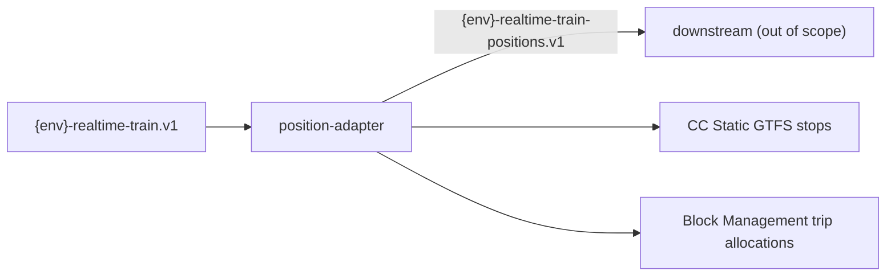

# Train — the position adapter

A trimmed copy of the hand-written [omnia](https://github.com/augentic/omnia)
guest for realtime train services, cut to the one pipeline the `train` eval
case ports from TypeScript: train-update XML in, vehicle location events out.
It is the reference a `--build --target omnia` run of the eval compares the
built guest with, and the source of the recorded fixtures the built guest is
driven through; nothing in the eval runs its tests.

Domain logic lives under `crates/*` as plain
`pub async fn name<P>(input, Context<P>)` handlers. The **guest is the
workspace root package** (`src/lib.rs`): an `axum::Router` with no route of
its own and an exact-topic messaging router over a provider-owning `Client`.
The layout follows [omnia-exemplar](https://github.com/augentic/omnia-exemplar).

## Quick start

```shell
# build the guest
cargo build --target wasm32-wasip2 --release

# run it with the example host runtime
cp .env.example .env   # then fill in values
set -a; source .env; set +a
cargo run --features host --example runtime -- run target/wasm32-wasip2/release/train.wasm
```

## Architecture



| Messaging topic | Handler |
| --- | --- |
| `{env}-realtime-train.v1` | `position_adapter::train_update` (XML) |

Published-only topic: `{env}-realtime-train-positions.v1`. Its consumer
lives outside this repository.

## Crate map

| Crate | Role |
| --- | --- |
| `crates/common` | Config key catalog, canonical route/topic tables, `TIMEZONE`, and the Block Management trip-allocations client |
| `crates/position-adapter` | Converts train updates into vehicle location events |
| root package (`train`) | Typed-router HTTP + exact-topic messaging WASM guest binary |

Domain crates depend only on the `omnia-sdk` capability traits (`Config`,
`HttpRequest`, `Identity`, `Publish`), so the same code runs inside the WASM
guest and against `omnia_test::guest::Provider` doubles in tests.

## Configuration

All keys are declared as constants in `common::config`; `.env.example`
carries placeholder values.

| Key | Purpose |
| --- | --- |
| `ENV` | Deployment environment; prefixes every topic (`dev-…`). Defaults to `dev` with a warning when unset |
| `BLOCK_MGT_URL` | Block Management API base URL |
| `CC_STATIC_URL` | CC Static (static GTFS) API base URL |
| `AZURE_IDENTITY` | Identity used to acquire access tokens for the upstream APIs |

The `IDENTITY_CLIENT_ID` / `IDENTITY_CLIENT_SECRET` / `IDENTITY_TOKEN_URL`
entries in `.env.example` are read by the example host's identity backend,
not the guest.

## Domain quirks

Service-specific requirements that are **not** general patterns:

- **Duplicate publish** — `position-adapter` publishes each vehicle event twice
  (`PUBLISH_REPEATS`) because a downstream schedule-adherence process needs
  the repeat. The legacy system also spaced the repeats with a blocking
  sleep; that was removed — never block a WASM guest.
- **Freshness window** — a train update older than sixty seconds, or more
  than thirty seconds in the future, is refused rather than published.

## Tests

- `crates/position-adapter/tests/static.rs` — the recorded fixtures under
  `data/static/`, each one XML message with the upstream answers it needs
  and the events it publishes, re-anchored to now.
- `crates/position-adapter/tests/replay.rs` — the recorded production messages
  under `data/replay/`, driven the same way.

Every fixture under `data/` carries an `output`: the seven recorded with
none (`static/0001`–`0005`, `replay/0049`, `replay/4247`) were given the
outcome `static.rs` and `replay.rs` assert for them, so the eval's oracle
reads each fixture as its own expectation.
- `tests/messaging.rs` and `tests/routes.rs` — the production topic and
  route tables driven natively over `omnia_test::guest::Provider` doubles.

```shell
cargo test --workspace
```
